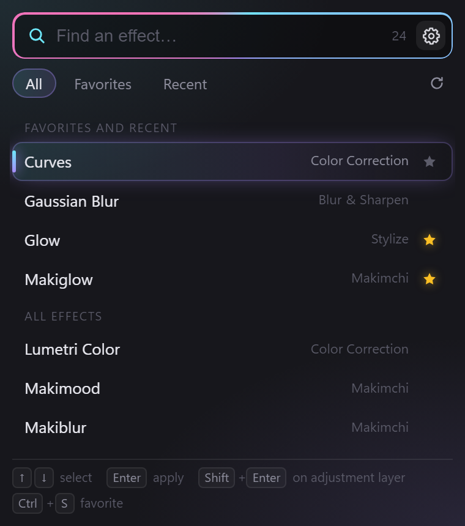
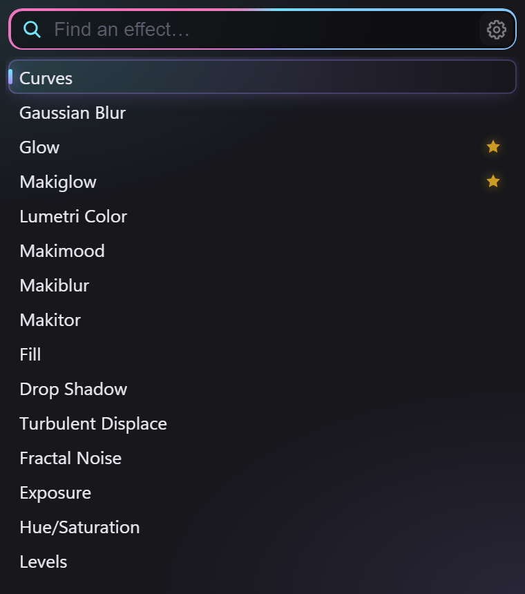
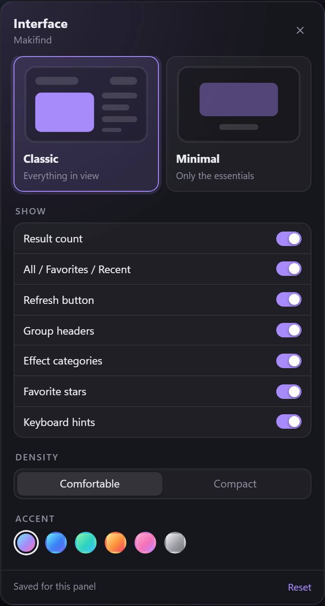

<p align="center"></p>

<p align="center">
  <a href="https://github.com/Moliiknis/Makifind/releases/latest"></a>
  <a href="https://github.com/Moliiknis/Makifind/releases"></a>
  
  
  <a href="LICENSE.md"></a>
</p>

<p align="center"><b>Find and apply any effect in two keystrokes</b><br><sub>Любой эффект за два нажатия</sub></p>

<p align="center"><b>English</b> · <a href="#русский">Русский</a></p>

<p align="center"><a href="https://github.com/Moliiknis/Makifind/releases/latest"><b>⬇ Download Makifind-1.1.0-Setup.exe</b></a></p>

## English

Type a few letters, press Enter, done. Makifind learns which effects you use and puts them first.

Similar to **FX Console (Video Copilot)**. Written from scratch: not affiliated with its authors and contains none of their code.

<table>
<tr><td width="33%" valign="top"><b>Fuzzy search</b><br><sub>Matches parts of words, match names and categories.</sub></td><td width="33%" valign="top"><b>Enter to apply</b><br><sub>On the selected layers, or Shift+Enter on a new adjustment layer.</sub></td><td width="33%" valign="top"><b>Favorites</b><br><sub>Star the effects you love with Ctrl+S.</sub></td></tr>
<tr><td width="33%" valign="top"><b>Learns from you</b><br><sub>Recent and frequent effects rise to the top.</sub></td><td width="33%" valign="top"><b>Keyboard first</b><br><sub>Arrows, Page Up/Down, Tab between filters.</sub></td><td width="33%" valign="top"><b>Two interfaces</b><br><sub>Classic, or Minimal: just the search and the list.</sub></td></tr>
</table>

### Two interfaces

Choose how much interface you see. Two presets come built in, **Classic** (everything in view) and **Minimal** (only the essentials), and you can build your own: which parts to show, density and accent color.
- **Makifind:** click ⚙ in the corner or use the panel menu (≡). The setup is saved for that panel.

<table>
<tr><td align="center"><b>Classic</b></td><td align="center"><b>Minimal</b></td></tr>
<tr><td></td><td></td></tr>
</table>

<p align="center"><br><sub>⚙ Interface settings: presets, parts to show, density, accent</sub></p>

### Install

1. Download **`Makifind-1.1.0-Setup.exe`** from [Releases](https://github.com/Moliiknis/Makifind/releases/latest).
2. Close After Effects and run the installer. No administrator rights needed.
3. Start After Effects and open **Window › Extensions › Makifind**.

> **SmartScreen?** The installer is not code-signed yet. Click *More info* → *Run anyway*.

<sub>After Effects 2021 or newer · Uninstall from *Settings → Apps → Makifind for After Effects*</sub>

<details>
<summary><b>Build from source</b></summary>

Nothing to compile: the panel is plain HTML and JavaScript.

```powershell
.\build-installer.ps1   # builds the plug-in and release\Makifind-1.1.0-Setup.exe
```

For development, `install.ps1` links the panel to the source folder instead of installing a copy.

</details>

### The Makimchi set

| Plug-in | What it does |
|---|---|
| [Makiglow](https://github.com/Moliiknis/Makiglow) | Soft, natural glow for After Effects |
| [Makimood](https://github.com/Moliiknis/Makimood) | Cinematic color grading with a live looks window |
| [Makiblur](https://github.com/Moliiknis/Makiblur) | Motion blur from the footage's own motion |
| [Makitor](https://github.com/Moliiknis/Makitor) | Smooth slow motion and speed ramps on the timeline |
| [Makiease](https://github.com/Moliiknis/Makiease) | Keyframe easing, one click away |
| **Makifind** | Find and apply any effect in two keystrokes |

### License

[PolyForm Noncommercial 1.0.0](LICENSE.md): free for personal and any noncommercial use; you may change it and share it. Commercial use (selling it, paid client work, use in a company for profit) is not allowed.

<br>

---

## Русский

Пара букв, Enter, готово. Makifind запоминает, какие эффекты ты используешь, и ставит их первыми.

Аналог **FX Console (Video Copilot)**. Написан с нуля: не связан с авторами оригинала и не содержит их кода.

<table>
<tr><td width="33%" valign="top"><b>Нечёткий поиск</b><br><sub>Находит по части слова, внутреннему имени и категории.</sub></td><td width="33%" valign="top"><b>Enter и готово</b><br><sub>На выделенные слои или Shift+Enter на новый корректирующий слой.</sub></td><td width="33%" valign="top"><b>Избранное</b><br><sub>Звёздочка или Ctrl+S.</sub></td></tr>
<tr><td width="33%" valign="top"><b>Учится</b><br><sub>Недавние и частые эффекты поднимаются наверх.</sub></td><td width="33%" valign="top"><b>С клавиатуры</b><br><sub>Стрелки, Page Up/Down, Tab между фильтрами.</sub></td><td width="33%" valign="top"><b>Два интерфейса</b><br><sub>Classic или Minimal: только поиск и список.</sub></td></tr>
</table>

### Два интерфейса

Можно выбрать, сколько интерфейса видно. Есть два готовых пресета: **Classic** (всё на виду) и **Minimal** (только главное). Можно и собрать свой вариант: какие части показывать, плотность и цвет акцента.
- **В Makifind** нужно нажать ⚙ в углу или выбрать пункт в меню панели (≡). Настройка сохраняется для этой панели.

### Установка

1. Нужно скачать **`Makifind-1.1.0-Setup.exe`** со страницы [Releases](https://github.com/Moliiknis/Makifind/releases/latest).
2. Нужно закрыть After Effects и запустить установщик. Права администратора не нужны.
3. Нужно открыть After Effects: **Окно › Расширения › Makifind**.

> **SmartScreen?** Установщик пока не подписан сертификатом. Нужно нажать *Подробнее* → *Выполнить в любом случае*.

<sub>After Effects 2021 и новее · Удаление: *Параметры → Приложения → Makifind for After Effects*</sub>

<details>
<summary><b>Сборка из исходников</b></summary>

Компилировать нечего: панель на обычных HTML и JavaScript.

```powershell
.\build-installer.ps1   # собирает плагин и release\Makifind-1.1.0-Setup.exe
```

Для разработки `install.ps1` подключает панель ссылкой на исходники вместо копии.

</details>

### Набор Makimchi

| Плагин | Что делает |
|---|---|
| [Makiglow](https://github.com/Moliiknis/Makiglow) | Мягкое естественное свечение для After Effects |
| [Makimood](https://github.com/Moliiknis/Makimood) | Кинематографичная цветокоррекция с живым окном луков |
| [Makiblur](https://github.com/Moliiknis/Makiblur) | Motion blur из собственного движения футажа |
| [Makitor](https://github.com/Moliiknis/Makitor) | Плавный слоумо и рампы скорости прямо на таймлайне |
| [Makiease](https://github.com/Moliiknis/Makiease) | Плавность ключей в один клик |
| **Makifind** | Любой эффект за два нажатия |

### Лицензия

[PolyForm Noncommercial 1.0.0](LICENSE.md): бесплатно для личного и любого некоммерческого использования, можно изменять и делиться. Коммерческое использование (продажа, платные заказы, использование в компании ради прибыли) не разрешено.

<p align="center"><sub>Made with care · <b>Makimchi</b></sub></p>
